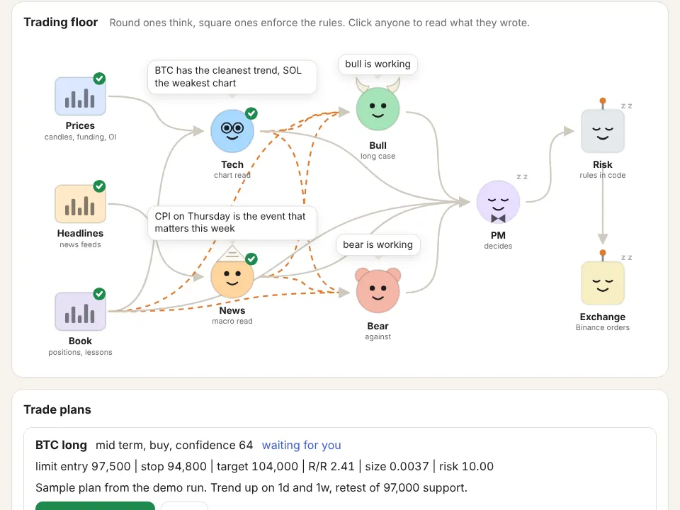

# tradedesk

A small crypto desk that runs on your own machine. Claude Code agents read the market every day and argue about it, a risk engine written in plain Python decides what's allowed and how big, and Binance holds the stop for every position. A local dashboard shows the whole thing as it happens.



## How a day works

`/daily` in Claude Code runs one pass:

1. `desk snapshot` first runs the scan (also on its own as `desk scan`): it looks at every Binance spot pair in the quote currency and picks the strongest movers by 7 day move against BTC, volume against its weekly average and ATR. Those join the watchlist and gold (PAXG) as today's assets. Then the snapshot pulls 4h, daily and weekly candles from Binance and turns them into a short text file per asset: EMAs, RSI, MACD, ATR, swing levels, funding, open interest and the long/short ratio, plus the fear and greed index. `desk news` collects the last 36 hours of headlines from CoinDesk, Cointelegraph, Decrypt and The Block and sorts them by asset. `desk book` writes down equity, open positions, recent results and the lessons from past reviews.
2. Two analysts run in parallel. The technical analyst reads only the snapshot and the list of today's assets. The news analyst reads the headlines and checks the macro calendar with at most three web searches.
3. A bull and a bear each read both reports and make their case, one round, 200 words each.
4. The main session acts as portfolio manager. It weighs both sides and writes `plans.json` with entry, stop, target, horizon and confidence per idea. It never sets size.
5. `desk check` runs every idea through the risk engine. It sizes the trade so a stop-out costs 1% of equity and rejects anything that breaks a rule: reward to risk under 2, a stop tighter than half an ATR, too much open risk, a daily loss over 3%, drawdown over 15%, an asset outside today's list, a short on spot.
6. Plans that pass wait for you in the dashboard. Approving one sends it to Binance.

Each agent has a word limit and reads files from the run folder instead of passing long reports through the conversation.

## Safety

Every order goes out with its stop already on the exchange, so a run that fails or a laptop that's off doesn't leave a position unprotected.

On spot, limit entries are sent as one OTOCO order list: the buy, and a stop-loss plus take-profit that activate when it fills. Market entries are followed by an OCO, and if that fails the coins are sold straight back. Spot is long only.

On USDⓈ-M futures, entries are market orders sent when price reaches the plan's level, in isolated margin. Stop and target go out right after as `closePosition` conditional orders on mark price. If the stop can't be placed, the position is closed at once. Futures limit entries need `desk watch` running, because the desk only sees the price when it syncs.

Stops only move in the trade's favor, and the sync moves them for you on a winner. Once a trade is up by its original risk (1R), the stop goes to entry plus fees. From 1.5R it trails 2 ATR behind the price (4h ATR for short trades, daily for the rest) and always keeps at least half the open gain. Every move goes to the exchange as a new stop, and `[trailing]` sets the numbers or turns it off.

Positions are closed when they outlive their horizon (3, 21 or 120 days by default). `desk kill --flatten` cancels everything and closes every position.

The agents can't approve trades, edit the risk code or read `.env`. `.claude/settings.json` blocks it.

This is a tool for running your own process, not a strategy that makes money. Most people who trade with leverage lose. Start in paper mode and stay there until the journal says otherwise.

## Setup

You need [uv](https://docs.astral.sh/uv/) and [Claude Code](https://code.claude.com).

```sh
git clone https://github.com/danieljancar/tradedesk.git
cd tradedesk
uv sync
cp desk.example.toml desk.toml
```

Paper mode needs no keys and simulates fills on live Binance candles. For testnet or live trading, copy `.env.example` to `.env` and add a Binance API key with trading permission only, withdrawals off and an IP restriction. Spot testnet keys come from [testnet.binance.vision](https://testnet.binance.vision).

Give the desk a Binance account or sub-account of its own and use it for nothing else. Equity counts every coin on that account that is on the watchlist, in the core targets or in an open position or order, so coins you hold there for yourself end up in the desk's sizing and drawdown numbers.

## Running it

```sh
uv run desk serve          # dashboard on http://127.0.0.1:8420
claude                     # then type /daily
```

To see the dashboard without any setup, `uv run desk demo` replays a made-up run on a separate database.

To run every morning, point cron or launchd at `scripts/daily.sh`. It calls `claude -p "/daily" --permission-mode dontAsk`, which allows only the commands listed in `.claude/settings.json`.

The Markets page shows each coin's chart with the desk's levels, plans and trades, the technical read, and its futures positioning from Binance: open interest, funding against the 0.01% baseline, long/short for all accounts and for top traders, and taker buy/sell, each with a one-line reading. The News page adds CoinGecko's most searched coins, marked by whether Binance lists them. The desk doesn't trade from that list.

To run more than one desk, say spot and futures with their own money, give each a config file with its own `db_path` and `runs_dir` and point `DESK_CONFIG` at it: `DESK_CONFIG=data/futures.toml uv run desk status`. Each gets its own dashboard with `desk serve --port 8431` and its own schedule. Keep their run times apart so two runs don't share a minute.

Once a week, `/review` (or `scripts/review.sh` on a schedule) runs `desk stats` and rewrites `lessons.md`, which the portfolio manager reads before every decision.

## Telegram

The desk can message you on Telegram and take your answer from there. You get a message when a plan passes the risk check (with Approve and Drop buttons unless `auto_execute` is on), when an entry fills, when a position closes by stop or target, when the exchange returns an error, when a run finishes and when the kill switch is used. A position without a working stop is always sent, even during quiet hours and even if `error` is left out of `events`.

1. Message [@BotFather](https://t.me/BotFather), send `/newbot` and copy the token it gives you.
2. Send your new bot any message, then open `https://api.telegram.org/bot<token>/getUpdates` in a browser. The number under `"chat":{"id":...}` is your chat id.
3. Put both in `.env` as `TELEGRAM_BOT_TOKEN` and `TELEGRAM_CHAT_ID`.
4. In `desk.toml` set `telegram = true` under `[notify]`. `events` picks which messages you get, `quiet_hours = "23-07"` holds back everything except errors and stop-outs during those local hours.
5. Run `uv run desk report --send` once to check it arrives.

`desk bot` long-polls Telegram and only answers your private chat with the bot: messages need a chat of type `private` with the id in `TELEGRAM_CHAT_ID`, and button presses also need to come from that user. Group chats are ignored, so don't add the bot to a group to use it there. Approve on a plan does the same as the dashboard: approve, then send that one plan to the exchange. Before any approved plan goes out the risk check runs again on the current price and account, and a plan that fails it is marked rejected. A proposal older than `entry_ttl_hours` can't be approved anymore and `desk sync` marks it expired. `/status` shows equity, open positions with open P&L and pending entries, `/plans` lists plans waiting with their buttons, `/report` sends the digest, `/kill` cancels every pending order and `/flatten` also closes every position. Both ask for a second tap, and that button stops working after 5 minutes.

On a Mac, `scripts/launchd/install.sh 07:30` installs two launchd jobs for your user: the bot, restarted if it stops, and `desk report --send` every morning at 07:30. Logs go to `data/logs/`. `scripts/launchd/install.sh --remove` takes both out again.

## Learning

Every idea counts, taken, passed or rejected. `desk learn` replays each one on real 1h candles until it hits its target or stop, expires unfilled or outlives its horizon, and stores the result with the market context of that day in the `outcomes` table. Each run's snapshot facts go to `snapshots`, together with what every asset did in the 24 and 72 hours after. `desk sync` updates both on the side, at most once an hour per idea.

`desk stats` (and `GET /api/learning`) turns that into calibration: hit rate and average R by confidence, asset, horizon, side and decision, the market after days with no ideas, and whether the bull or the bear side matched. Every number carries its sample size, and groups under 10 examples say "not enough data yet". Lessons may change how ideas are judged, never the risk limits. Once 10 ideas have resolved, `book.md` carries a one-line calibration summary.

## Risk profiles, core sleeve and performance

`[risk] profile` picks a set of limits: `conservative` risks 0.5% per trade with a 10% drawdown pause, `balanced` is the default set above, `aggressive` risks 2% with a 25% pause. Any limit you write in `[risk]` yourself overrides the profile, and the dashboard only writes back the keys that differ from it.

`[portfolio]` splits the account in two. `core_pct = 30` with `core_targets = { BTC = 60, PAXG = 40 }` keeps 30% of equity as a long-term core and lets the desk trade the other 70%. Trade size, open risk and the position cap use the active part only; the daily loss limit and the drawdown pause still use the whole account. `desk rebalance` shows each core asset's target, value and drift, and `desk rebalance --propose` turns any asset more than `rebalance_band_pct` under its target into a market buy plan with sleeve `core`, a stop 35% under entry and a target at 1.9x. These skip the confidence, reward/risk and ATR rules, but not exchange minimums, free cash, the daily loss limit or the drawdown pause, and they wait for approval like any plan. An asset over its band gets trims: whole core lots, newest first, that bring it down without going under target. Trims sit in the `trims` table until you run `desk trim ID` (or approve them in the dashboard) and then `desk execute`. Trims of an asset you removed from `core_targets` always wait for your approval, even with `auto_execute` on. Core positions never expire, and the plans file can't close them or move their stops. The core needs `market = "spot"`; on futures the rebalance does nothing.

`confident_risk_x` in `[risk]` sizes up when the portfolio manager is sure. At 2, a plan at `min_confidence` risks the normal `risk_per_trade_pct`, a plan at `confident_at` (85 by default) or higher risks twice that, and everything in between scales in a straight line. The cap on all open stops, the protected floor and the futures liquidation check still apply, and the book tells the agents that confidence now sets the size.

`desk analytics` (and `GET /api/analytics`) prints total return, max and current drawdown, Sharpe and Sortino (after 14 days), best and worst day, win rate, profit factor, expectancy in R and in quote, and the same per asset, horizon, side, sleeve and exit reason, next to BTC bought and held over the same days. `GET /api/portfolio` has equity in quote and in `base_currency`, both sleeves, allocation by asset and asset class, core drift and the waiting rebalance. The CHF value uses FRED's DEXSZUS rate with USDT counted as USD; when FRED doesn't answer the output says so.

## Commands

| Command | What it does |
| --- | --- |
| `desk scan` | Pick today's assets from the whole spot market |
| `desk snapshot`, `news`, `book` | Write the day's input files |
| `desk check plans.json` | Validate and size ideas |
| `desk plans`, `approve ID`, `reject ID` | Review proposed plans |
| `desk execute` | Send approved plans |
| `desk sync` | Pick up fills, stops, targets, expiries |
| `desk watch` | Keep syncing every 5 minutes |
| `desk status` | Equity and open positions |
| `desk stop ID PRICE`, `close ID` | Manage a position |
| `desk kill [--flatten]` | Cancel everything |
| `desk journal` | Closed trades with R multiples |
| `desk learn` | Replay every idea on real candles into `outcomes` |
| `desk stats` | Calibration report for `/review` |
| `desk report [--send]` | Short digest, printed or sent to Telegram |
| `desk bot` | Telegram bot for approvals, status and the kill switch |
| `desk rebalance [--propose]` | Core targets against holdings, and plans to close the gaps |
| `desk trim ID [--reject]` | Approve or drop a core trim |
| `desk analytics` | Returns, drawdown, ratios and trade stats |

## Configuration

`desk.example.toml` lists every setting with its default: mode (`paper`, `testnet`, `live`), market (`spot`, `futures`), watchlist, risk limits, hold times and whether passing plans go out without approval.

The `[universe]` section controls the scan. Pairs under 20M USDT of 24h volume are skipped, stablecoins, fiat and leveraged tokens never show up, and `exclude` drops any asset you don't want. The scan adds its top 6 movers after the watchlist, the `always` list and PAXG, up to 12 assets a day. Scan picks go through the same risk rules as everything else. With `enabled = false` the desk uses only the watchlist, like before.

## Development

```sh
uv run pytest
uv run ruff check
uv run ruff format
```

The dashboard is a React app in `frontend/` (Vite, shadcn/ui, Lightweight Charts, Recharts, Motion). The built files are committed in `src/tradedesk/web/dist`, so running the desk only needs uv. To change the UI you need Node and pnpm:

```sh
cd frontend
pnpm install
pnpm dev      # hot reload on :5173, talks to `desk serve` on :8420
pnpm build    # writes src/tradedesk/web/dist
```

Binance calls are tested against recorded responses in `tests/test_exchange.py`, the paper flow end to end in `tests/test_paper_flow.py`.

The roles and the debate follow [TradingAgents](https://github.com/TauricResearch/TradingAgents). The order safety rules (protect or close, validate prices in code, never trust a number the model wrote) come from reading [NOFX](https://github.com/NoFxAiOS/nofx) and [Freqtrade](https://www.freqtrade.io).

## License

MIT
